<p align="center">
  
</p>

<h1 align="center">WinShield Pro v6.2 Enterprise Edition</h1>

<p align="center">
  <strong>Central Definitiva de Diagnóstico de Hardware, Saúde de Discos, Drivers Oficiais, Benchmark, Segurança Forense e Otimização Avançada para Windows 10 e 11.</strong>
</p>

<p align="center">
  <a href="https://github.com/andreygiordane/WinShieldPro/raw/main/dist/WinShieldPro.exe">
    
  </a>
</p>

<p align="center">
  
  
  
  
  
</p>

---

## 🌟 Visão Geral

O **WinShield Pro v6.2 Enterprise** é uma suíte desktop profissional projetada para usuários exigentes, técnicos, analistas de suporte, gamers e administradores de TI. Desenvolvida nativamente para Windows com **arquitetura de alto desempenho**, **interface moderna reativa** e execução de comandos com privilégios de Administrador (UAC) de forma **100% invisível** — sem janelas pretas de CMD ou PowerShell piscando na tela.

A versão **6.2** traz motores de hardware de nível baixo (**Silicon Core™**, **Vision Engine™**, **RAMGuard™** e **DiskGuard™**), download direto de drivers de servidores oficiais (**NVIDIA, AMD, Intel, Realtek**) com pareamento inteligente, benchmark físico real e um gerenciador de processos reconstruído para tempo de resposta instantâneo.

---

## 📥 Download Direto do Executável

Não é necessário instalar Python, dependências ou compiladores para utilizar o WinShield Pro:

* 🚀 **[Clique aqui para Baixar o WinShieldPro.exe (v6.2 Standalone)](https://github.com/andreygiordane/WinShieldPro/raw/main/dist/WinShieldPro.exe)**
* 🔒 **Assinado Digitalmente:** Binário assinado via certificado Authenticode por *Andrey Giordane*.
* 🛡️ **Zero Dependências Externas:** Executável portátil integrado (*Single File*) pronto para rodar.

---

## 📸 Demonstração Visual & Galeria de Recursos

### 🖥️ 1. Visão Geral do Sistema & Telemetria em Tempo Real (Dashboard)
Painel de comando principal com diagnóstico instantâneo de processador, uso e alocação de RAM, partição do sistema, badges S.M.A.R.T. de integridade física dos discos e especificações de placa-mãe, BIOS e TPM.

<p align="center">
  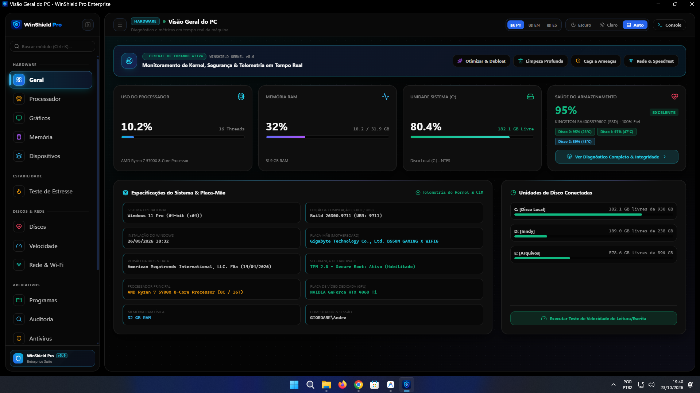
</p>

<details>
  <summary><strong>🌓 Alternância de Tema: Modo Claro (Light Theme)</strong> (Clique para expandir)</summary>
  <br>
  <p align="center">
    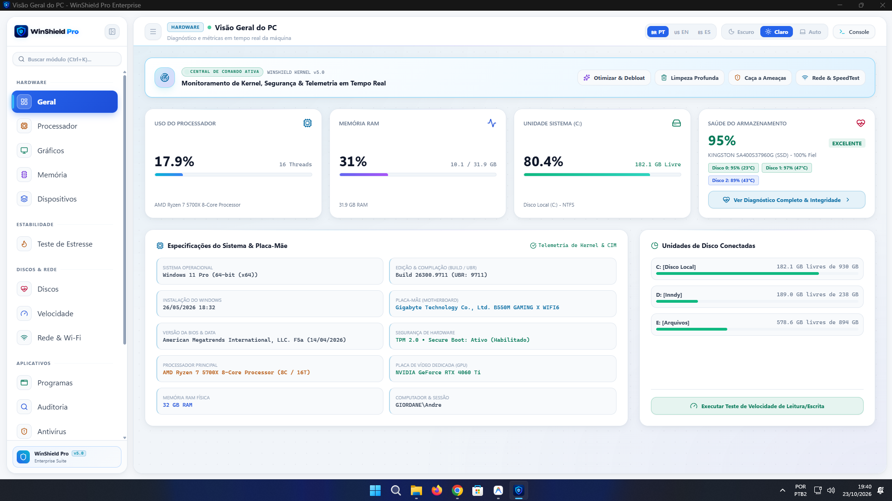
  </p>
</details>

---

### ⚙️ 2. WinShield CoreEngine™ (Processador, Arquitetura & Caches)
Extração de nível de engenharia de arquitetura de CPU: litografia de fabricação, codinome (ex: *AMD Zen 3 Vermeer / Intel Raptor Lake*), multiplicador de clock dinâmico, conjunto de instruções (x86-64, AVX2, FMA3, AES, SHA) e mapeamento hierárquico de caches L1 D-Cache, L1 I-Cache, L2 e L3 unificado.

<p align="center">
  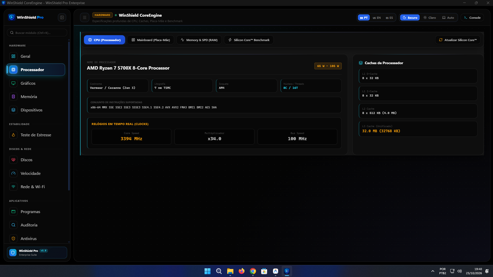
</p>

---

### 🎮 3. WinShield VisionEngine™ (Placa Gráfica, VRAM & Sensores)
Mapeamento de GPU dedicada e integrada: Die, contagem de transistores, núcleos de computação (CUDA Cores / Stream Processors), barramento de memória GDDR6/X, largura de banda em GB/s e sensores de temperatura de GPU, Hotspot, consumo em Watts e clocks em tempo real.

<p align="center">
  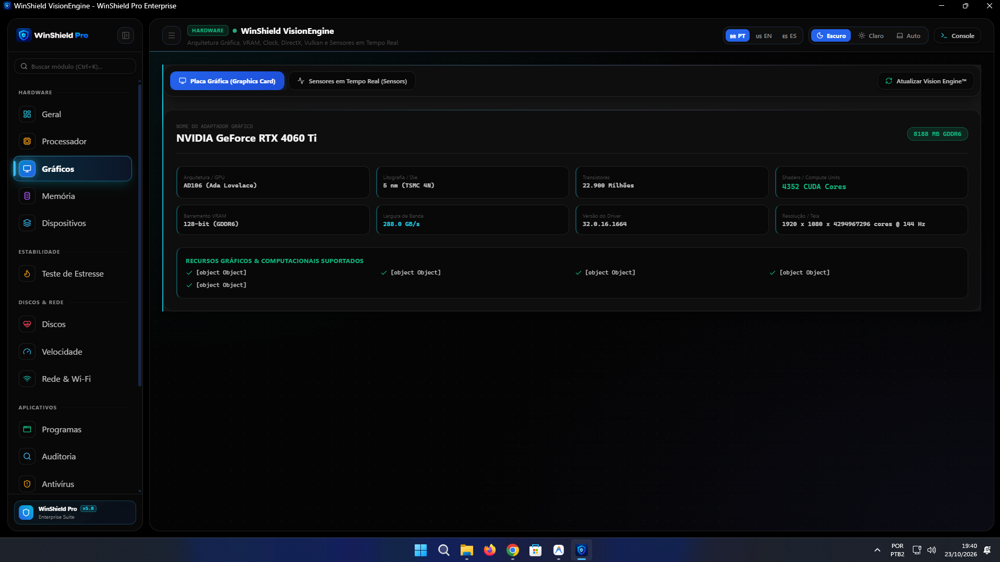
</p>

---

### 🧠 4. WinShield RAMGuard™ (Diagnóstico Físico & Purgador de Cache)
Mapeamento de pentes físicos nos slots da placa-mãe (SPD), frequência real em MHz, tensão em Volts, part número e número de série dos módulos. Conta com botão de **Purga de Cache Standby** e teste de integridade física de células de memória (*RAMGuard™86 Architecture*).

<p align="center">
  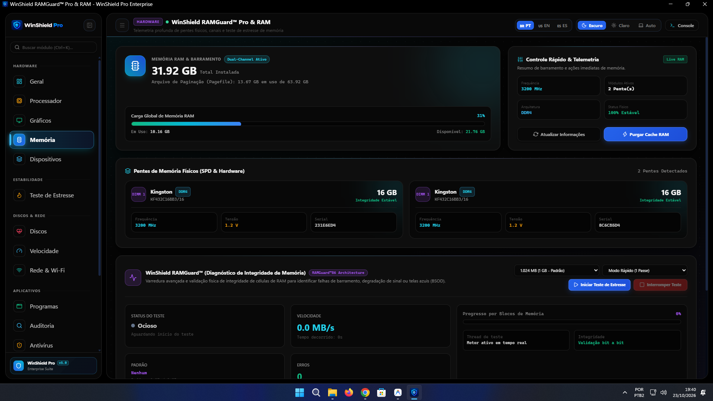
</p>

---

### 🔌 5. Central de Dispositivos & Pareamento de Drivers Oficiais
Auditoria de barramento Plug & Play (PnP), identificação de drivers homologados Microsoft WHQL e **pareamento inteligente com servidores de grandes fabricantes**. O WinShield Pro consulta as CDNs oficiais da **NVIDIA**, **AMD**, **Intel** e **Realtek**, permitindo baixar e instalar os drivers mais recentes diretamente pela interface.

<p align="center">
  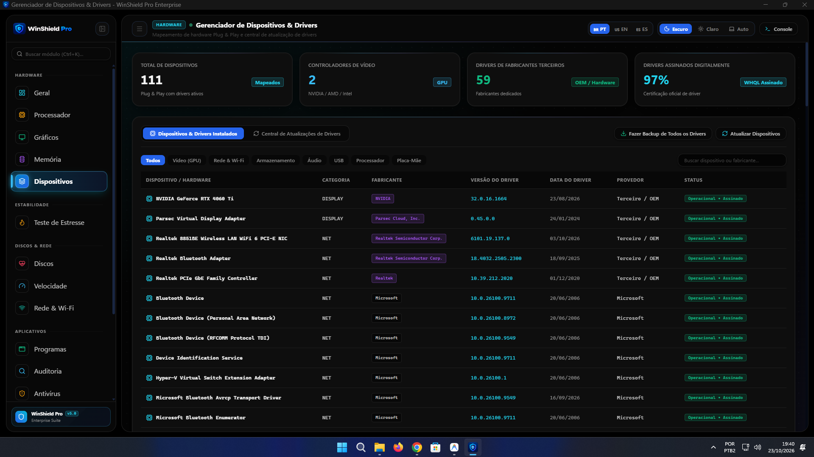
</p>

---

### 🔥 6. WinShield StressPulse™ (Teste de Estabilidade & Osciloscópio Térmico)
Bateria de estresse multithread paralelo com carga combinada de CPU, FPU, Caches, Memória RAM e GPU. Conta com osciloscópio térmico por núcleo em tempo real e sensor automatizado de **CPU Thermal Throttling**.

<p align="center">
  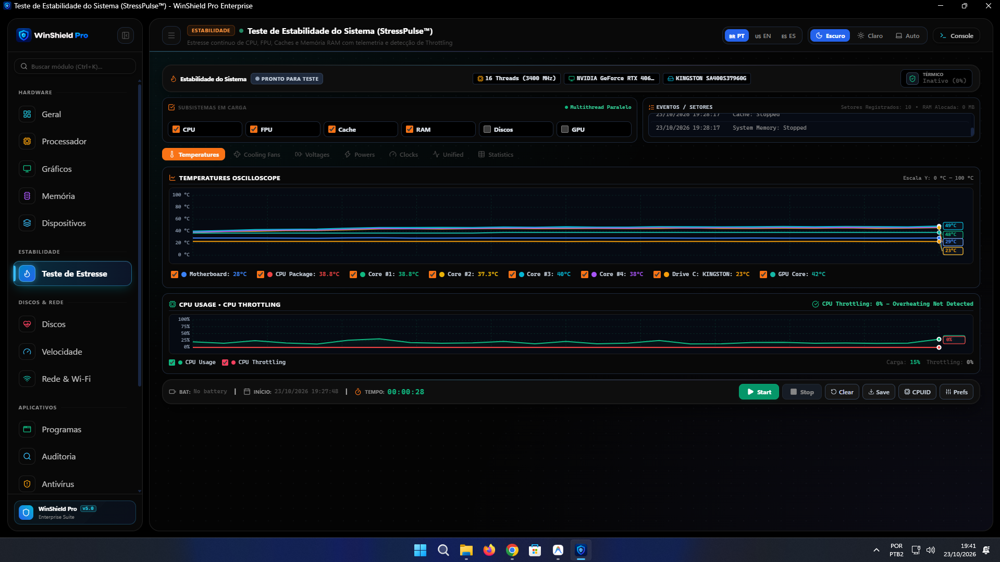
</p>

---

### 💾 7. WinShield DiskGuard™ & SurfaceScan™ (Saúde S.M.A.R.T. e Varredura Física)
* **DiskGuard:** Leitura profunda de registros S.M.A.R.T. e telemetria NVMe PCIe via IOCTL nativo: horas de funcionamento, volume gravado (TBW), temperatura do controlador e cálculo de saúde percentual.
* **SurfaceScan:** Varredura física em **1.200 blocos LBA** com I/O direto (`FILE_FLAG_NO_BUFFERING`) identificando blocos rápidos (< 12ms), normais, lentos (> 180ms) e danificados (Bad Blocks / CRC).

<p align="center">
  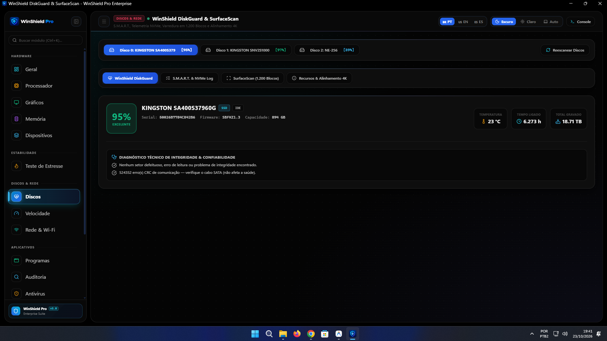
</p>

<details>
  <summary><strong>🔍 Visualizar Grade de Superfície LBA (SurfaceScan)</strong> (Clique para expandir)</summary>
  <br>
  <p align="center">
    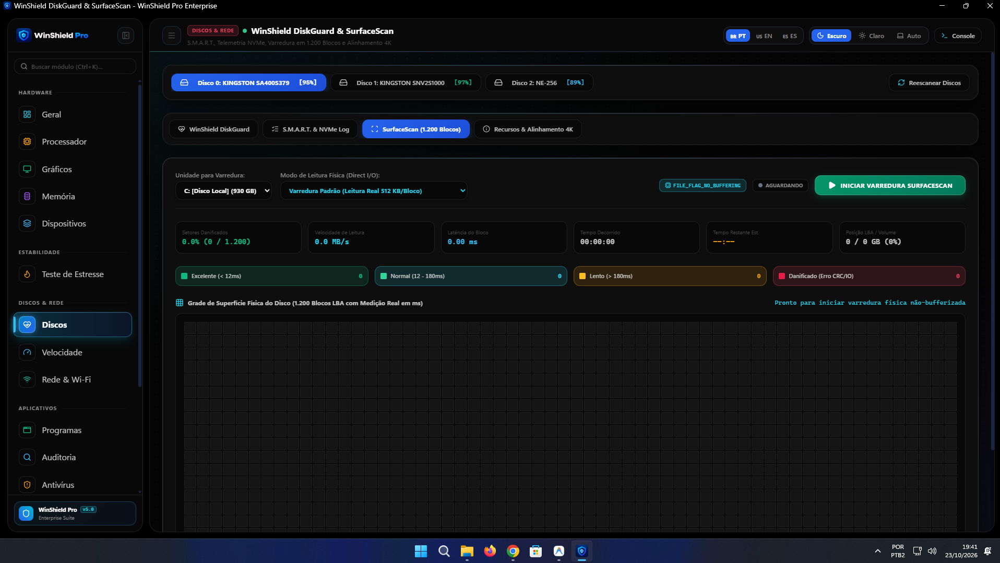
  </p>
</details>

---

### ⚡ 8. WinShield DiskSpeed Turbo™ (Benchmark Físico sem Cache de RAM)
Mede a taxa de transferência e latência física real dos discos evitando distorções provocadas pela memória RAM:
* **SEQ1M Q8T1 / Q1T1:** Leitura e gravação sequencial de alta largura de banda.
* **RND4K Q32T1 / Q1T1:** Leitura e gravação aleatória de 4 KiB com cálculo real de **IOPS** e microssegundos ($\mu\text{s}$).

<p align="center">
  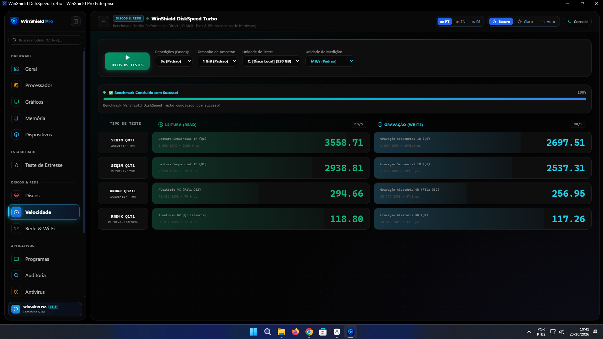
</p>

---

### 🌐 9. Central de Rede, Wi-Fi, Ping & SpeedTest
Diagnóstico de adaptadores de rede, qualidade de sinal Wi-Fi ou conexão cabeada, IP local, IP público e provedor. Inclui velocímetro de Download e Upload integrado via **Cloudflare Global Edge Network**, jitter, latência mundial e ações de reparo rápido em 1 clique (Limpar DNS, Renovar IP, Reset Winsock, Reset TCP/IP).

<p align="center">
  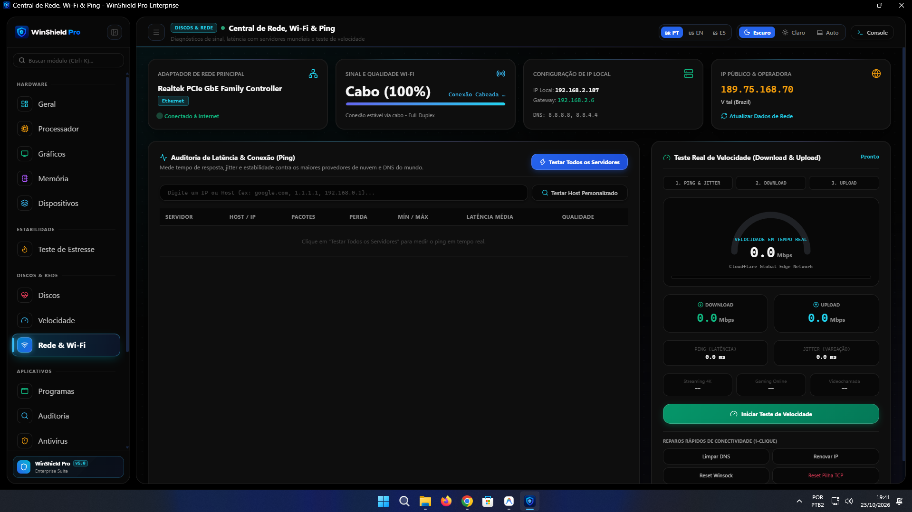
</p>

---

### 📦 10. Gerenciador de Aplicativos & Processos Ativos
Motor de alta performance em C (`psutil` + `Win32 EnumWindows`) capaz de mapear centenas de processos em **0,14s**. Separa de forma inteligente entre **Softwares do Usuário** e **Serviços do Windows**, associando janelas abertas, consumo de memória, ícones de marca e atalhos rápidos para Finalizar ou Desinstalar.

<p align="center">
  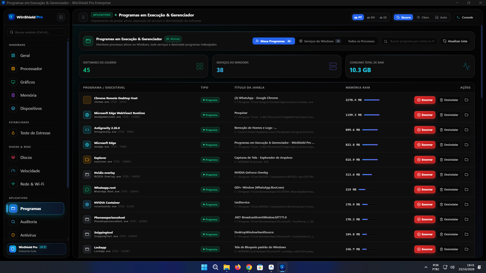
</p>

---

### 🔍 11. Auditoria Profunda de Softwares, Apps Ocultos & Desinstalador
Mapeia o Registro do Windows (HKLM 32/64 bits e HKCU) localizando softwares instalados e **aplicativos ocultos (`SystemComponent = 1`)**. Permite desocultar programas no Painel de Controle, gerenciar pacotes AppX / UWP da Microsoft Store, serviços de terceiros e programas na Inicialização Automática (Startup).

<p align="center">
  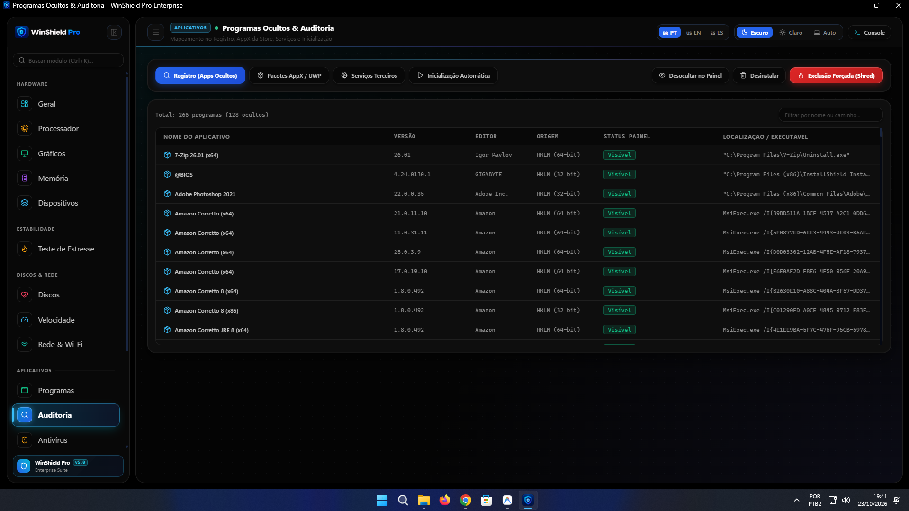
</p>

---

### 🛡️ 12. Central de Segurança, Antivírus & ThreatHunter
Módulo de segurança com varredura heurística em tempo real contra ataques de *Masquerade* (binários com nomes críticos como `svchost.exe` fora do System32), scanner de scripts e executáveis não assinados em `%TEMP%`, varredura profunda de integridade do System32 e integração direta com o **Microsoft Defender**.

<p align="center">
  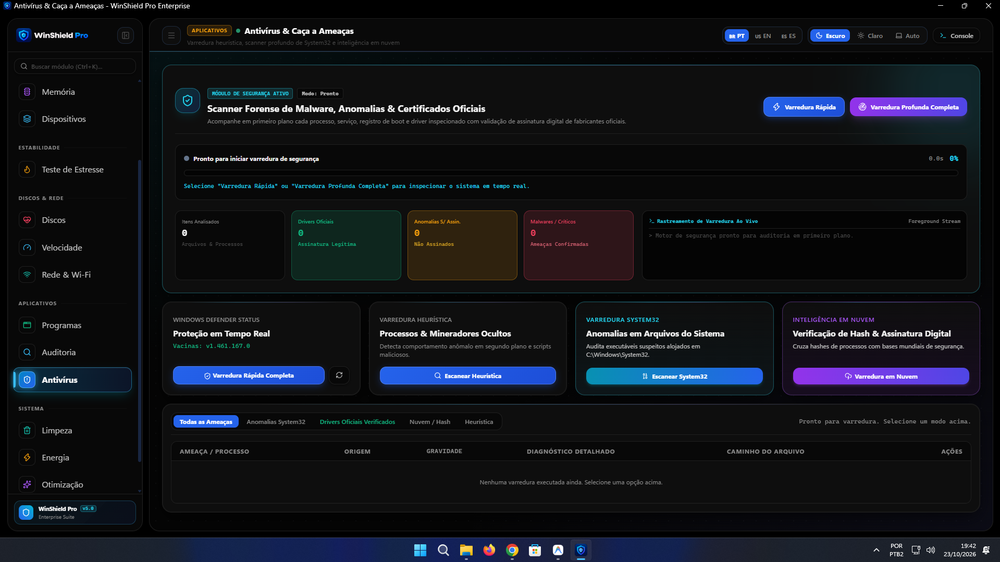
</p>

---

### 🧹 13. WinShield DeepCleaner™ (Limpeza Profunda do Windows)
Varredura segura e exclusão de gigabytes acumulados em arquivos temporários (`%TEMP%`, `Windows\Temp`), cache de instaladores do Windows Update (`SoftwareDistribution`), relatórios de erro e despejos de memória (`WER` / `CrashDumps`), miniaturas do Explorer, logs CBS/DISM e caches de navegadores (Chrome, Edge, Brave e Firefox).

<p align="center">
  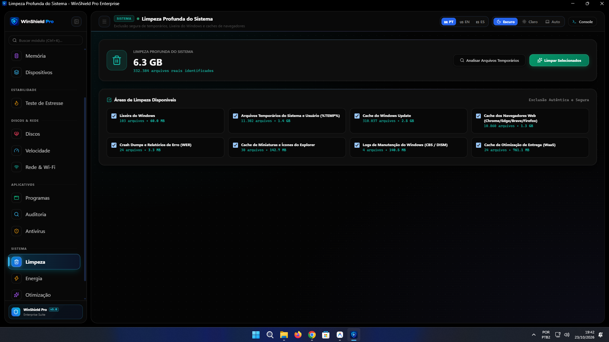
</p>

---

### ⚡ 14. Planos de Energia & Desempenho Máximo (PowerCfg)
Desbloqueia e ativa com 1 clique o plano oculto **Desempenho Máximo (Ultimate Performance)** do Windows para resposta instantânea de CPU sem estacionamento de núcleos (Core Parking). Permite gerenciar esquemas instalados e criar planos personalizados com frequências dinâmicas.

<p align="center">
  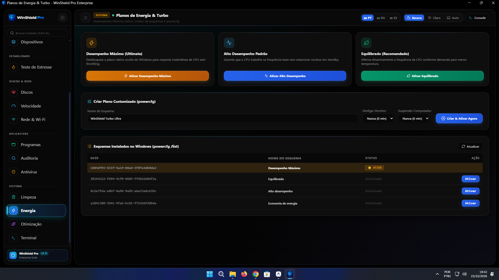
</p>

---

### 🏎️ 15. Otimizações do Sistema & Debloat Adaptativo de Hardware
Motor inteligente que identifica a configuração do computador e recomenda otimizações específicas:
* **Escalonador de CPU:** Prioridade multimídia e separação de quantum de threads no kernel (`Win32PrioritySeparation`).
* **Calibragem de RAM & SysMain:** Ajuste sob demanda para prevenir desgaste de SSDs.
* **DirectX & GPU:** Agendamento de GPU acelerado por hardware (**HAGS**) e fila de renderização MMCSS.
* **Armazenamento:** Otimização periódica TRIM para células flash e fila I/O NTFS.
* **Rede de Baixa Latência:** Desativação do algoritmo de Nagle (**TCP NoDelay**) e RSS.
* **Debloat do Windows:** Desativação de telemetrias nativas de rastreamento (`DiagTrack` e `dmwappushservice`).

<p align="center">
  
</p>

---

### 💻 16. Terminal CMD & PowerShell Administrativo Integrado
Console de execução de comandos com elevação administrativa automática, atalhos de diagnósticos em 1 clique (`netstat`, maiores consumidores de RAM, volumes de disco) e visualização de saída estruturada.

<p align="center">
  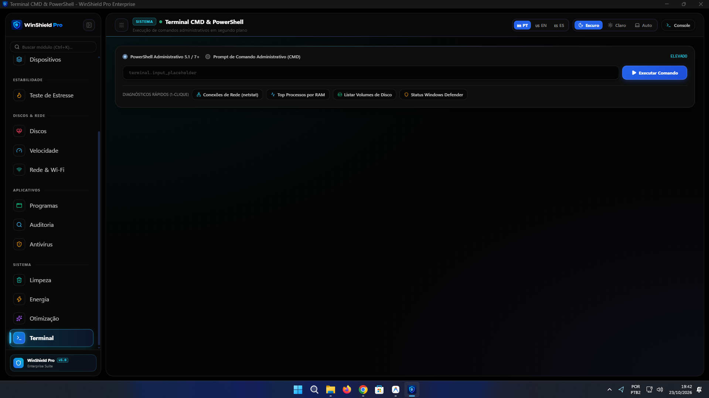
</p>

---

## 🏗️ Arquitetura de Software & Performance

O projeto foi construído sobre princípios rígidos de **Clean Architecture**, alta manutenibilidade e baixo impacto de hardware:

```text
WinShieldPro/
├── backend/                           # Núcleo de Engenharia e APIs do Sistema
│   ├── api/
│   │   ├── controllers/               # Controladores desacoplados de entrada REST
│   │   └── router.py                  # Roteador de despacho HTTP
│   ├── app_manager_engine.py          # Gestão de processos (psutil + Win32 EnumWindows < 0.15s)
│   ├── audit_engine.py                # Auditoria de Registro, AppX, Serviços e Inicialização
│   ├── cleaner_engine.py              # Motor de limpeza profunda e coleta de temporários
│   ├── core.py                        # Detecção de privilégios de Administrador e flags do sistema
│   ├── device_engine.py               # Pareamento de hardware e download de drivers oficiais
│   ├── disk_engine.py                 # Telemetria S.M.A.R.T., NVMe IOCTL e SurfaceScan LBA
│   ├── hardware_monitor.py            # WinShield CoreEngine™, VisionEngine™ e CPU Benchmark
│   ├── log_manager.py                 # Telemetria e logs circulares em tempo real
│   ├── network_engine.py              # SpeedTest (Cloudflare Edge), ping mundial e reparo de sockets
│   ├── optimizer_engine.py            # Otimizações de kernel, HAGS, TCP NoDelay e debloat
│   ├── power_engine.py                # Gestor de esquemas de energia powercfg
│   ├── process.py                     # Execução de processos 100% invisíveis (sem janelas piscando)
│   ├── security_engine.py             # ThreatHunter, heurística e integração Windows Defender
│   ├── stress_engine.py               # Motor de estresse multithread e osciloscópio térmico
│   ├── system_engine.py               # Métricas de hardware ao vivo e leitura direta do Registro
│   └── terminal_engine.py             # Execução de comandos PowerShell 5.1/7+ e CMD
│
├── frontend/                          # Interface Web Moderna e Componentes
│   ├── css/                           # Estilos base e Tailwind utilitário
│   ├── js/
│   │   ├── controllers/               # Controladores reativos para cada página da suíte
│   │   ├── core/                      # Lucide batching rAF, roteamento, temas e polling leve
│   │   └── i18n/                      # Traduções completas em Português, Inglês e Espanhol
│   ├── pages/                         # Módulos modulares em HTML puro
│   └── winshield_pro_dashboard.html   # Dashboard mestre compilado
│
├── certificates/                      # Certificados de assinatura de código Authenticode
├── dist/                              # Executável portátil compilado e assinado (WinShieldPro.exe)
├── docs/screenshots/                  # Capturas de tela de demonstração em alta resolução
├── imagens/                           # Logotipos, ícones e artes visuais do projeto
├── scripts/
│   ├── build_frontend.py              # Empacotador modular do frontend
│   └── sign_app.ps1                   # Script automatizado de assinatura digital Authenticode
├── tests/                             # Bateria completa de testes automatizados (pytest)
├── build_exe.bat                      # Script 1-clique de compilação do executável .EXE
├── run_as_admin.bat                   # Inicializador seguro com elevação UAC
├── version_info.txt                   # Metadados oficiais do executável (v6.2.0.0)
└── winshield_app.py                   # Ponto de entrada da aplicação desktop
```

---

## ⚡ Como Executar a partir do Código-Fonte

### Pré-requisitos
* Sistema Operacional: **Windows 10 ou 11 (64-bit)**
* **Python 3.8+** instalado (recomendado 3.11 ou 3.15)
* Privilégios de Administrador no Windows

### Passo a Passo

1. **Clonar o Repositório:**
   ```bash
   git clone https://github.com/andreygiordane/WinShieldPro.git
   cd WinShieldPro
   ```

2. **Instalar as Dependências:**
   ```bash
   pip install -r requirements.txt
   ```

3. **Executar a Aplicação:**
   * Diretamente com privilégios de administrador:
     ```bash
     python winshield_app.py
     ```
   * Ou utilizando o script automatizado com elevação UAC:
     ```cmd
     run_as_admin.bat
     ```

---

## 🔨 Como Compilar o Executável Standalone (.EXE)

Para compilar o aplicativo em um arquivo executável único, integrado e assinado digitalmente:

Execute o script de compilação em lote:
```cmd
build_exe.bat
```

O script realizará automaticamente:
1. Validação do ambiente Python e instalação do PyInstaller.
2. Recompilação modular de todos os arquivos HTML/JS/CSS do frontend.
3. Empacotamento em modo Windowed puro (`--windowed`) com manifesto UAC embutido via `WinShieldPro.spec`.
4. Assinatura digital Authenticode com certificado emitido para **Andrey Giordane**.
5. Geração do executável final em `dist/WinShieldPro.exe`.

---

## 🧪 Testes Automatizados & Qualidade de Código

O WinShield Pro possui uma suíte rigorosa de 26 testes automatizados que cobrem desde a integridade da arquitetura até a conformidade com as diretrizes do sistema operacional:

```bash
python -m pytest
```

```text
============================= test session starts =============================
platform win32 -- Python 3.15.1, pytest-9.1.1
collected 26 items

tests\test_brand_compliance.py ..                                        [  7%]
tests\test_clean_architecture.py ......                                  [ 30%]
tests\test_core.py ....                                                  [ 46%]
tests\test_device_engine.py .......                                      [ 73%]
tests\test_log_manager.py .                                              [ 76%]
tests\test_network_engine_speed.py ...                                   [ 88%]
tests\test_resource_resolution.py ..                                     [ 96%]
tests\test_stress_engine.py .                                            [100%]

============================= 26 passed in 22.02s =============================
```

---

## 👤 Autor & Desenvolvedor

Desenvolvido com excelência técnica por **Andrey Giordane**:

* **GitHub:** [@andreygiordane](https://github.com/andreygiordane)
* **Repositório Oficial:** [https://github.com/andreygiordane/WinShieldPro](https://github.com/andreygiordane/WinShieldPro)

---

## 📄 Licença

Distribuído sob a licença **MIT** com proteções de marca registrada para os motores **WinShield Silicon Core™**, **Vision Engine™**, **RAMGuard™**, **DiskGuard™** e **StressPulse™**. Consulte o arquivo [LICENSE](LICENSE) para mais detalhes.
